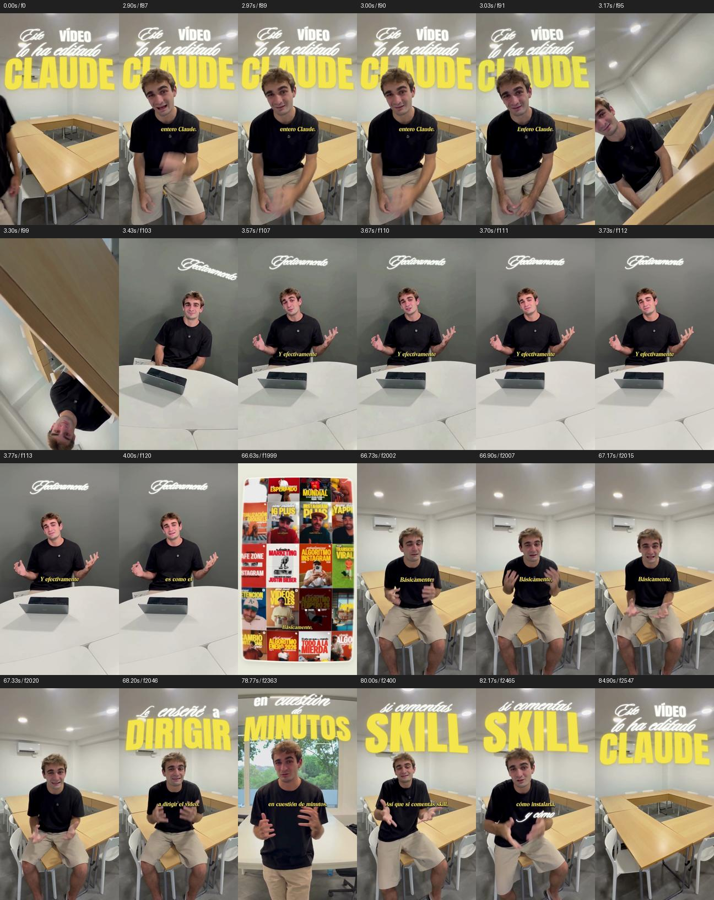

# Estilo Guille Collado · skill de Claude Code

Le das a Claude tus brutos y te devuelve el reel editado con el acabado de Guille Collado: titulares con brillo detrás de ti, pantallas crema en ángulo, transiciones de cámara, subtítulos y diseño sonoro.

Es la skill con la que se editó el vídeo «Día 1» de [@janmoliner.ia](https://www.instagram.com/janmoliner.ia/). Es una reproducción del estilo hecha por Jan Moliner, no un proyecto oficial de Guille Collado.



## Instalar

Necesitas [Claude Code](https://claude.com/claude-code), Python 3.11 o superior, ffmpeg y Node.

```bash
git clone https://github.com/janmo22/guille-collado.git ~/.claude/skills/guille-collado
pip install -r ~/.claude/skills/guille-collado/requirements.txt
python3 ~/.claude/skills/guille-collado/scripts/project.py doctor
```

El último comando te dice qué te falta.

## Lo que pones tú

Hay cuatro cosas que no van en el repo porque tienen licencia:

| Qué | Dónde |
|---|---|
| Fuente **Sloop ScriptOne** (Font Bureau), para la cursiva | `assets/fonts/SloopScriptOne.ttf` |
| Fuente **Toledo-Serial BoldItalic** (SoftMaker), para los subtítulos | `assets/fonts/Toledo-Serial-BoldItalic.ttf` |
| La **canción** (en el Día 1 fue un instrumental con mucha energía) | Se la pasas a Claude al editar |
| **Efectos de sonido**: pop, click suave, click de ratón, whoosh, card flip, boom grave y brillo | `assets/sfx/` |

Anton ya viene incluida (licencia OFL). Si no tienes alguna de las otras, Claude te pedirá cuál usar en su lugar.

## Usar

Abre Claude Code en la carpeta donde tengas tus tomas y dile:

> Edita estos brutos estilo Guille

Una sola toma también sirve. Claude transcribe, elige las mejores frases, monta, pone textos, transiciones y sonido, renderiza y lo revisa antes de entregarte el MP4.

## Qué hay dentro

- `SKILL.md`: las instrucciones que lee Claude.
- `references/`: dirección visual, montaje, sonido, motion y producción.
- `scripts/`: inventario del proyecto, conformado de tomas, texto, lente angular, mezcla y verificación.
- `assets/runtime/`: el kit de Remotion para componer.
- `assets/golden/` y `assets/recipe/`: el vídeo de referencia y su código, para estudiar cómo se hizo.
